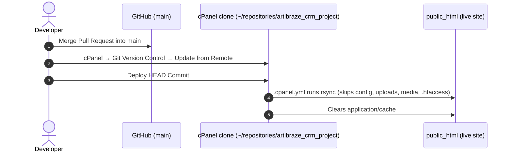

# ArFashion Deployment Guide (cPanel Git Version Control)

Live site: `https://arfashion.nexgeno.cloud/` → `/home2/arfashionnexgeno/public_html`
Repository: **https://github.com/Zaid5514/artibraze_crm_project**

This server has **no Terminal / SSH shell**, so deployment is semi-manual (same as lumifog):
GitHub `main` → cPanel **Update from Remote** → cPanel **Deploy HEAD Commit** → files rsynced into `public_html`.

When the host enables SSH, switch to fully automatic deploys. See [Upgrading to automatic deploys](#upgrading-to-automatic-deploys-later).

---

## How it works



| Copied to `public_html` on deploy | Never touched |
|---|---|
| Every file tracked in git (PHP, JS, CSS, `php.ini`, `.user.ini` …) | `application/config/app-config.php`, `.htaccess*` |
| | `uploads/`, `modules/*/uploads/`, `media/`, `temp/`, `application/logs/` |
| | Files that exist only on the server (rsync runs without `--delete`, so it never removes files) |

> [!WARNING]
> Deploy overwrites any tracked file edited directly on the server. **From now on, change code only through git.**
> If the webhost edits `php.ini` / `.user.ini` again, copy that change into the repo too.

---

## One-time setup

### Step 1: Back up the live site
cPanel → **File Manager** → right-click `public_html` → **Compress** → Zip. Download the zip, then delete it from the server.
While you're in File Manager, **delete `public_html/clean_duplicate_receives.php`**. It's a leftover one-off script that anyone can open in a browser.

### Step 2: Give cPanel read access to the private GitHub repo (Deploy Key)

1. cPanel → **SSH Access** → **Manage SSH Keys**.
   - If a private key named **`id_rsa`** is already listed, use it and skip to item 3.
   - Otherwise, **Generate a New Key**: Key Name **`id_rsa`** (this exact name, so git uses it automatically), **no password**, Type **RSA**, Size **4096**.
2. You do **not** need to click "Authorize" for this key. Authorizing is only for logging *in* to the server.
3. Under **Public Keys**, click **View/Download** next to `id_rsa` and copy the text (starts with `ssh-rsa`).
4. GitHub → https://github.com/Zaid5514/artibraze_crm_project/settings/keys → **Add deploy key**
   - Title: `cPanel arfashion server`
   - Key: paste the public key
   - **Leave "Allow write access" unticked**, then click **Add key**.

### Step 3: Clone the repo in cPanel
cPanel → **Git™ Version Control** → **Create**
- **Clone a Repository:** ON
- **Clone URL:** `git@github.com:Zaid5514/artibraze_crm_project.git`
- **Repository Path:** `repositories/artibraze_crm_project` ⚠️ **not** `public_html`
- **Repository Name:** `artibraze_crm_project`
- Click **Create**.

**If the clone fails:**
| Error | Fix |
|---|---|
| `Host key verification failed` | File Manager → Settings → tick **Show Hidden Files**. Open `/home2/arfashionnexgeno/.ssh/`, create a file `known_hosts`, and paste in the `github.com …` lines from GitHub's [SSH key fingerprints page](https://docs.github.com/en/authentication/keeping-your-account-and-data-secure/githubs-ssh-key-fingerprints). Retry. |
| `Permission denied (publickey)` | The key isn't named `id_rsa`, or the deploy key wasn't added to *this* repo. |
| Still stuck | Fallback: clone over HTTPS with a **fine-grained token** (GitHub → Settings → Developer settings → Fine-grained tokens → only this repo → *Contents: Read-only*). Clone URL: `https://<TOKEN>@github.com/Zaid5514/artibraze_crm_project.git`. Note: the token expires, and it stops working once the repo moves to Nexgeno. |

### Step 4: First deploy
cPanel → Git Version Control → **Manage** (next to `artibraze_crm_project`) → **Pull or Deploy** tab → **Deploy HEAD Commit**.
Then open the site, log in, and check the dashboard, **Cash Flow Group** report and **Warehouse → Opening stock**.

> The `.cpanel.yml` first checks that `public_html/index.php` exists, and stops if the path is wrong. It doesn't copy anything until that check passes.

---

## Every deployment (daily workflow)

1. Work on a branch locally:
   ```
   git checkout -b feature/my-change
   # edit, commit
   git push -u origin feature/my-change
   ```
2. On GitHub: open a **Pull Request** and **Merge** into `main`.
3. cPanel → **Git™ Version Control** → **Manage** → **Pull or Deploy**:
   1. **Update from Remote** (pulls the new commits into the cPanel clone)
   2. **Deploy HEAD Commit** (copies them into `public_html`)
4. Check "Last Deployment Information" on that page shows your commit, then hard-refresh the site (Ctrl+F5).

Enable the local guard that blocks direct pushes to `main` (once per clone):
```
git config core.hooksPath cicd/githooks
```

---

## Files

| File | Purpose |
|---|---|
| `.cpanel.yml` | Deploy instructions cPanel runs on **Deploy HEAD Commit** (must stay in the repo root). |
| `cicd/githooks/pre-push` | Blocks direct pushes to `main`. |
| `cicd/deploy-ssh.yml.reference` | Fully automatic GitHub Actions workflow, kept here until SSH is available. |
| `cicd/CPANEL_CICD_SETUP_GUIDE.md` | This guide. |

---

## Upgrading to automatic deploys later

When the host enables SSH / Terminal:
1. Move `cicd/deploy-ssh.yml.reference` to `.github/workflows/deploy.yml`.
2. **Authorize** a key under SSH Access (this one is for logging in), and find the SSH port.
3. Add these GitHub secrets:
   - `CPANEL_SSH_HOST`
   - `CPANEL_SSH_PORT`
   - `CPANEL_SSH_USER` = `arfashionnexgeno`
   - `CPANEL_SSH_KEY`
   - `CPANEL_PROJECT_PATH` = `/home2/arfashionnexgeno/public_html`
4. In Terminal, run `cd ~/public_html && git init && git remote add origin https://github.com/Zaid5514/artibraze_crm_project.git`.
After that, every merge into `main` deploys by itself in about 10 seconds.

## When the repo is transferred to Nexgeno-Developers
- Deploy keys move with the repo, and GitHub redirects the old URL, so cPanel keeps pulling.
- Locally, run `git remote set-url origin https://github.com/Nexgeno-Developers/artibraze_crm_project.git`, then update the links in this guide.
