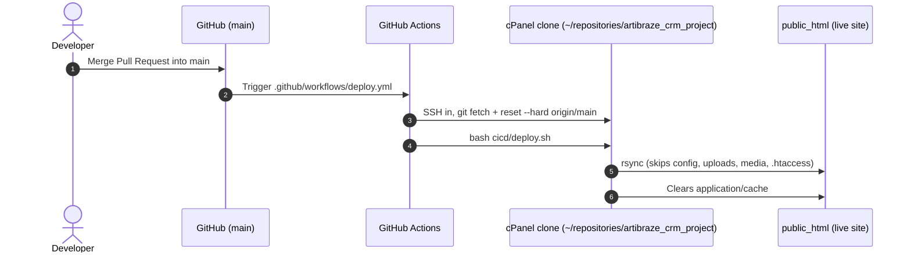

# ArFashion Deployment Guide (GitHub Actions → cPanel over SSH)

Live site: `https://arfashion.nexgeno.cloud/` → `/home2/arfashionnexgeno/public_html`
Repository: **https://github.com/Nexgeno-Developers/artibraze_crm_project**
cPanel clone: `/home2/arfashionnexgeno/repositories/artibraze_crm_project`

Every merge into `main` deploys automatically in about 15 seconds.

---

## How it works



`cicd/deploy.sh` holds the copy logic. The GitHub Action runs it, and so does cPanel's **Deploy HEAD Commit** button (through `.cpanel.yml`), so the manual fallback behaves the same way.

There is **no `.git` folder in `public_html`**. Git lives only in `~/repositories/`, so it can't be downloaded from the website.

| Copied to `public_html` on deploy | Never touched |
|---|---|
| Every file tracked in git (PHP, JS, CSS, `php.ini`, `.user.ini` …) | `application/config/app-config.php`, `.htaccess*` |
| | `uploads/`, `modules/*/uploads/`, `media/`, `temp/`, `application/logs/` |
| | Files that exist only on the server (rsync runs without `--delete`, so it never removes files) |

> [!WARNING]
> Deploy overwrites any tracked file edited directly on the server. **Change code only through git.**
> If you delete a file in git, delete it from `public_html` by hand too (rsync never deletes).

---

## One-time setup

### Step 1: Point the cPanel clone at the Nexgeno repo
Open cPanel → **Terminal** and run:
```bash
cd ~/repositories/artibraze_crm_project
git remote set-url origin https://github.com/Nexgeno-Developers/artibraze_crm_project.git
git fetch origin && git status
```
(The workflow also does this on every run, but doing it now confirms the clone can reach GitHub.)

### Step 2: Create an SSH key for GitHub Actions
Still in Terminal:
```bash
mkdir -p ~/.ssh && chmod 700 ~/.ssh
ssh-keygen -t ed25519 -f ~/.ssh/github_actions -N "" -C "github-actions-arfashion"
cat ~/.ssh/github_actions.pub >> ~/.ssh/authorized_keys
chmod 600 ~/.ssh/authorized_keys
cat ~/.ssh/github_actions        # copy ALL of this, including the BEGIN/END lines
```
If ed25519 is rejected, use `-t rsa -b 4096` instead.

Alternatively: cPanel → **SSH Access** → **Manage SSH Keys** → Generate, then click **Manage → Authorize** on the new key.

### Step 3: Find the SSH host and port
- Host: `shared122.accountservergroup.com`
- Port: shown on cPanel → **SSH Access** (or ask the host). It's often `22`, but some hosts use a custom port.
- User: `arfashionnexgeno`

Terminal inside cPanel does **not** prove that outside SSH is allowed. If the first Action run times out on connect, ask the host to allow SSH from outside (GitHub Actions IPs).

### Step 4: Add GitHub secrets
GitHub → repo → **Settings → Secrets and variables → Actions → New repository secret**:

| Secret | Value |
|---|---|
| `CPANEL_SSH_HOST` | `shared122.accountservergroup.com` |
| `CPANEL_SSH_PORT` | the port from Step 3 (omit if 22) |
| `CPANEL_SSH_USER` | `arfashionnexgeno` |
| `CPANEL_SSH_KEY` | the private key from Step 2 |
| `CPANEL_SSH_PASSPHRASE` | only if the key has a passphrase |
| `CPANEL_REPO_PATH` | optional, defaults to `/home2/arfashionnexgeno/repositories/artibraze_crm_project` |

### Step 5: First run
GitHub → **Actions** → **Deploy to cPanel Production** → **Run workflow** (on `main`).
The log lists every file it copied and ends with `✅ Deployment Successful!`. Then open the site and check that you can log in.

After that, delete the private key from the server: `rm ~/.ssh/github_actions` (keep the `.pub` and `authorized_keys`).

---

## Every deployment (daily workflow)

1. Work on a branch locally:
   ```
   git checkout -b feature/my-change
   # edit, commit
   git push -u origin feature/my-change
   ```
2. On GitHub: open a **Pull Request** and **Merge** into `main`.
3. Watch the **Actions** tab. When it turns green, hard-refresh the site (Ctrl+F5).

Enable the local guard that blocks direct pushes to `main` (once per clone):
```
git config core.hooksPath cicd/githooks
```

### Manual fallback
If Actions is down or SSH breaks: cPanel → **Git™ Version Control** → **Manage** → **Pull or Deploy** → **Update from Remote**, then **Deploy HEAD Commit**. It runs the same `cicd/deploy.sh`.

---

## Files

| File | Purpose |
|---|---|
| `.github/workflows/deploy.yml` | Auto-deploys on every push to `main`, and can also be run by hand from the Actions tab. |
| `cicd/deploy.sh` | The deploy itself: rsync into `public_html` and clear the cache. |
| `.cpanel.yml` | Lets cPanel's **Deploy HEAD Commit** button run `cicd/deploy.sh` (must stay in the repo root). |
| `cicd/githooks/pre-push` | Blocks direct pushes to `main`. |
| `cicd/CPANEL_CICD_SETUP_GUIDE.md` | This guide. |

## Troubleshooting

| Symptom | Fix |
|---|---|
| `Connection timed out` | Wrong port, or the host blocks outside SSH. Check `CPANEL_SSH_PORT` / ask the host. |
| `Permission denied (publickey)` | The key isn't in `~/.ssh/authorized_keys`, or the secret is missing lines. Paste the whole key again. |
| `cd: ... No such file or directory` | The clone path differs. Set `CPANEL_REPO_PATH` to the path shown in cPanel → Git Version Control. |
| `test -f .../index.php` fails | `DEPLOYPATH` in `cicd/deploy.sh` is wrong. |
